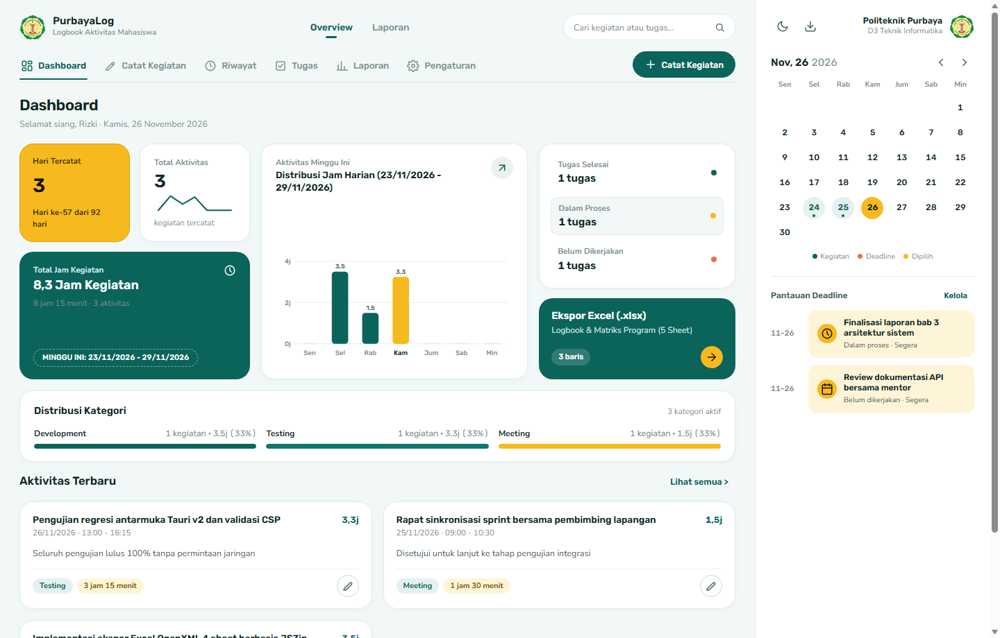
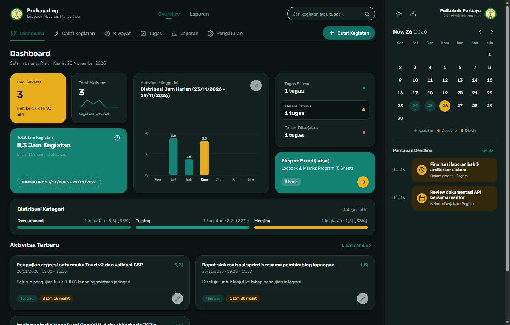

# PurbayaLog

Aplikasi desktop pencatat logbook aktivitas harian, manajemen tugas, dan pembuat laporan Excel otomatis untuk mahasiswa **Politeknik Purbaya** — mendukung pencatatan **MBKM**, **PKL**, **Magang**, maupun kegiatan akademik lapangan lainnya secara **100% offline**.

Dibangun agar ringan, cepat dibuka setiap hari, dan menjaga data tetap tersimpan aman di komputer pribadi tanpa bergantung pada koneksi internet atau server eksternal.

---

## Teknologi yang Digunakan

PurbayaLog memisahkan antarmuka ringan di sisi frontend dengan lapisan I/O native di sisi backend:

| Teknologi | Peran dalam Sistem |
|---|---|
| **Rust** | Backend inti (`core/` & `src-tauri/`): penulisan file atomik, cadangan otomatis (`.bak`), *safety backup* sebelum restore, pencatatan log, dan validasi jalur ekspor. |
| **Tauri v2** | Framework aplikasi desktop berbasis WebView2 bawaan Windows, menghasilkan installer ringkas (~1,8 MB) dengan izin sistem minimum. |
| **JavaScript (ES Modules)** | Seluruh logika aplikasi, validasi formulir, kalkulasi durasi/periode, manajemen state, dan perenderan DOM tanpa framework tambahan maupun bundler. |
| **HTML5 & CSS3** | Tata letak *bento grid* 2 kolom, mode terang/gelap (*Light/Dark Mode*), serta tipografi lokal (**Nunito** & **Rubik**). |
| **OpenXML (JSZip)** | Generator workbook `.xlsx` murni di sisi klien dengan *freeze pane*, *autofilter*, format waktu `[h]:mm`, dan tata letak siap cetak A4. |

---

## Tampilan Aplikasi

| Mode Terang | Mode Gelap |
|---|---|
|  |  |

---

## Fitur Utama

- **Dashboard Ringkas:** Rekap hari tercatat, total aktivitas, total jam kegiatan, grafik batang distribusi jam mingguan (SVG), distribusi kategori, serta pantauan deadline tugas.
- **Catat Kegiatan:** Validasi input per kolom, perhitungan durasi otomatis, dan peringatan bila meninggalkan formulir yang belum tersimpan (saat pindah halaman maupun menutup jendela aplikasi).
- **Riwayat & Kalender:** Pencarian cepat yang tersinkron dari *topbar*, filter kategori dan rentang tanggal, tampilan tabel berpaginasi, serta tampilan kalender interaktif.
- **Manajemen Tugas:** Pengaturan prioritas, perubahan status langsung, dan penanda visual untuk tugas yang mendekati atau melewati tenggat waktu.
- **Ekspor Laporan Excel (`.xlsx` — 5 Sheet):**
  - *Data Kegiatan*: rincian harian lengkap dengan kolom `Ket.`, baris `JUMLAH JAM KEGIATAN`, dan blok pengesahan 3 pihak.
  - *Rekapitulasi*: ringkasan informasi mahasiswa, instansi/mitra, dan statistik per kategori.
  - *Daftar Tugas* & *Refleksi*: rangkuman progres tugas serta catatan pembelajaran/kendala/solusi.
  - *Matriks Program*: matriks bulanan tanggal `1`–`31` dikelompokkan per kategori, penanda warna hari aktif, akumulasi `JML Jam`, dan blok tanda tangan (**Pembimbing Instansi**, **Dosen Pembimbing**, dan **Mahasiswa**).
  - Judul dan nama file otomatis menyesuaikan **Jenis program** di Pengaturan (`Umum`, `MBKM`, `PKL`, atau `Magang`).
- **Backup & Restore (`.json`):** Ekspor cadangan data terverifikasi dan pemulihan aman dengan pembuatan salinan pengaman otomatis sebelum data aktif diganti.

---

## Instalasi (Untuk Pengguna)

Bagi rekan mahasiswa yang ingin langsung menggunakan aplikasi tanpa menginstal perangkat pengembang:

1. Buka halaman **Releases** pada repository ini.
2. Unduh file **`PurbayaLog_1.0.0_x64-setup.exe`** *(atau versi `.msi` jika diperlukan)*.
3. Jalankan installer dan ikuti langkah pemasangan hingga selesai.

> Jika muncul peringatan *Windows protected your PC* (SmartScreen) karena aplikasi belum ditandatangani dengan sertifikat berbayar, klik **More info** lalu pilih **Run anyway**.

---

## Pengembangan & Build dari Source

### Prasyarat (Windows 10/11 64-bit)

- [Node.js LTS](https://nodejs.org/)
- [Rust & Cargo](https://rustup.rs/) (`stable-x86_64-pc-windows-msvc`)
- Microsoft C++ Build Tools (*Desktop development with C++*)
- WebView2 Runtime (umumnya sudah terpasang di Windows 10/11)

### Menjalankan & Membuild

```bat
npm install
npm run dev         :: Menjalankan aplikasi desktop dalam mode pengembangan
npm run build       :: Membangun binary release dan installer Windows (.exe / .msi)
npm run serve       :: Pratinjau frontend di browser (http://127.0.0.1:5173, penyimpanan localStorage)
```

Atau jalankan skrip otomatis `build_windows.bat` untuk menguji dan membangun installer sekaligus.

### Pengujian Otomatis

```bat
npm run test        :: Menjalankan 64 unit test & integrasi UI JavaScript (node:test)
npm run test:rust   :: Menjalankan 16 unit test modul inti Rust (cargo test)
npm run test:all    :: Menjalankan seluruh pengujian JS dan Rust
```

---

## Struktur Proyek

```text
├── core/                   Crate Rust mandiri (tulis atomik, backup pengaman, validasi jalur)
├── src/                    Frontend aplikasi (HTML, CSS, font lokal, JS ES Modules, JSZip)
│   ├── js/core/            Logika bisnis murni (dates, validators, store, report, backup, xlsx)
│   ├── js/ui/              Komponen UI, ikon SVG, grafik, dan halaman aplikasi
│   └── js/platform.js      Jembatan IPC Tauri dengan fallback browser untuk pengembangan
├── src-tauri/              Konfigurasi Tauri v2, ikon aplikasi, dan command handler Rust
├── tests/                  Pengujian unit & integrasi (`node:test`) serta E2E
├── tools/                  Server statis lokal untuk mode pratinjau browser
└── THIRD_PARTY.md          Daftar lisensi pustaka & aset pihak ketiga
```

---

## Penyimpanan Data & Keamanan

- **Lokasi data lokal (Windows):** `%LOCALAPPDATA%\com.purbayalog.app\purbayalog-data.json` (disertai `.bak`, folder `backups\`, dan `logs\purbayalog.log`; dapat diarahkan ulang lewat variabel lingkungan `PURBAYALOG_DATA_DIR`).
- **Penulisan atomik:** Perubahan disimpan ke file sementara terlebih dahulu lalu di-*rename*, sehingga pemadaman mendadak saat menyimpan tidak merusak data utama.
- **Privasi & CSP ketat:** Kebijakan `default-src 'none'` tanpa `fetch`/XHR ke luar jaringan, tanpa `innerHTML` untuk input pengguna, serta sanitasi sel Excel agar teks berawalan `=` tidak dieksekusi sebagai rumus.

Detail komponen pihak ketiga dapat dilihat di [THIRD_PARTY.md](THIRD_PARTY.md).

---

<sub>Sky | The Public</sub>
